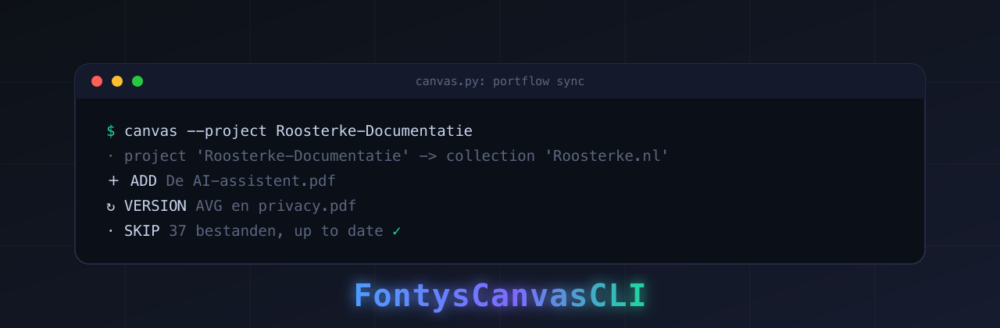

<p align="center">
  
</p>

<h1 align="center">Canvas Portfolio CLI</h1>

<p align="center">
  Zet een map met documenten netjes en herhaalbaar in je Portflow-portfolio, met klikbare @-verwijzingen in de leeswijzer.
</p>

<p align="center">
  
  
  
</p>

---

Deze tool zet een lokale map met documenten om in portfolio-bewijs op Portflow
(`portfolio.drieam.app`), bereikt via Instructure Canvas. Hij leest je bestaande
portfolio en synchroniseert je map ernaartoe: nieuwe bestanden komen erbij,
gewijzigde bestanden krijgen een nieuwe versie, en ongewijzigde bestanden blijven
met rust. Opnieuw draaien is dus veilig. Daarnaast kan hij de leeswijzer van een
verzameling opbouwen als een verhaal dat naar je documenten linkt, en reviews
aanvragen of je portfolio delen (die vragen altijd eerst om bevestiging).

De tool is niet aan één project gebonden: je wijst hem naar een willekeurige
projectmap. De standaardinstellingen zijn op Fontys afgestemd, maar alles wat
instellingsspecifiek is, is instelbaar, zodat het werkt voor elke Instructure
Canvas plus Drieam Portflow.

## Installeren als Claude Code-skill

Deze repo is ook een Claude Code-plugin met een skill, zodat je er in Claude Code
tegen kunt praten ("zet mijn bewijs in portflow", "maak de leeswijzer met links").
In een Claude Code-sessie:

```text
/plugin marketplace add NoelisTired/canvas-portflow-cli
/plugin install canvas-portflow@canvas-portflow-cli
```

Of in de terminal:

```bash
claude plugin marketplace add NoelisTired/canvas-portflow-cli
claude plugin install canvas-portflow@canvas-portflow-cli --scope user
```

De skill draait de eenmalige setup (venv + Playwright + onboarding) bij het eerste
gebruik. Daarna roep je 'm aan met `/canvas-portflow:canvas`. Je kunt de tool ook
puur als CLI gebruiken, zie hieronder.

## Snel starten als CLI (onboarding)

De makkelijkste weg is de onboarding-wizard. Die vraagt waar je documenten staan
en wat de URLs van je instelling zijn, schrijft een config-bestand en biedt aan
om meteen in te loggen:

```bash
git clone https://github.com/NoelisTired/canvas-portflow-cli.git
cd canvas-portflow-cli
python3 -m venv .venv
./.venv/bin/pip install -r requirements.txt
./.venv/bin/python -m playwright install chromium
./.venv/bin/python canvas.py --init
```

De wizard vraagt onder andere: "Waar wil je je portfoliodocumenten op baseren?"
Daar geef je de projectmap op. Er wordt nooit een wachtwoord opgeslagen.

## Geen wachtwoord nodig

De aanbevolen manier van inloggen slaat nergens een wachtwoord op. Je logt één
keer zelf in een zichtbaar browservenster in (jij typt je eigen wachtwoord, de
tool ziet het niet), en het browserprofiel onthoudt de sessie voor volgende,
headless runs:

```bash
./.venv/bin/python canvas.py --login
```

Wil je volledig headless draaien op je eigen machine, dan kun je optioneel
inloggegevens in een secrets-bestand of in omgevingsvariabelen zetten (zie
Inloggegevens onderaan). De tool gebruikt ze alleen om het loginformulier in te
vullen; hij onderschept, bewaart of toont nooit een wachtwoord.

## Hoe een project eruitziet

Je wijst de tool naar een projectmap. Daarin:

```
mijn-portfolio/
  reader.txt                 # de leeswijzer/intro, met @-verwijzingen (optioneel)
  <Leeruitkomst 1>/          # één map per leeruitkomst
    Een document.pdf
    Nog een document.pdf
  <Leeruitkomst 2>/
    ...
```

- Elke **submap is een leeruitkomst**; de bestanden erin worden bewijs dat aan
  die leeruitkomst wordt gekoppeld (de koppeling stel je in met `goal-map.json`).
- De optionele **`reader.txt`** (of `reader.md`) is de intro van de verzameling.
  Schrijf gewone tekst en verwijs naar een document met `@[Documentnaam.pdf]`; de
  tool maakt van elke verwijzing een klikbare link naar dat bewijs. Zo wordt de
  leeswijzer een chronologisch verhaal dat naar de documenten linkt.
- Bestaat er een submap `output/`, dan wordt die als bron gebruikt; anders de
  projectmap zelf.

## Instellen (voor een andere instelling dan Fontys)

De wizard schrijft `canvas.config.json` voor je. Je kunt dat bestand ook met de
hand maken: kopieer `canvas.config.example.json` en vul je waarden in. Volgorde
van toepassing: omgevingsvariabele, dan config-bestand, dan de Fontys-standaard.

| Instelling | Omgevingsvariabele | Wat het is |
| --- | --- | --- |
| `canvas_url` | `CANVAS_URL` | De basis-URL van je Canvas, bijv. `https://<instelling>.instructure.com/` |
| `portflow_host` | `PORTFLOW_HOST` | De Portflow-host (meestal `portfolio.drieam.app`) |
| `portflow_launch_url` | `PORTFLOW_LAUNCH_URL` | De Canvas-launch-URL van het Portfolio-item in de navigatie |
| `ntfy_topic` | `CANVAS_NTFY_TOPIC` | Optioneel ntfy.sh-topic voor een melding na het uploaden; leeg = uit |
| `project_dir` | (geen) | Standaard projectmap (de wizard vult dit) |

Het config-bestand bevat geen geheimen. Het browserprofiel (`.pw-profile/`) en
een eventueel secrets-bestand blijven uit git via `.gitignore`.

## Gebruik

Draai altijd eerst een proefrun, lees het plan, en voer daarna pas uit.

```bash
# Controle: inloggen, launchen, en de portfoliostructuur tonen
./.venv/bin/python canvas.py --whoami

# Proefrun: bron en verzameling worden uit de projectmap afgeleid
./.venv/bin/python canvas.py --project /pad/naar/mijn-portfolio

# Uitvoeren, pas nadat je het plan hebt gelezen en goedgekeurd
./.venv/bin/python canvas.py --project /pad/naar/mijn-portfolio --apply

# De leeswijzer bouwen uit reader.txt (met @-verwijzingen), vervangt de huidige
./.venv/bin/python reader.py --project /pad/naar/mijn-portfolio --set
./.venv/bin/python reader.py --project /pad/naar/mijn-portfolio --mentionable  # toont @-namen
```

Overschrijven kan met `--source <map>` en `--collection "<naam>"`. `--project`
valt terug op `project_dir` uit de config, anders de huidige map. `--reseed`
herstelt de lokale wijzigingsdetectie zonder te uploaden; `--ntfy` stuurt een
melding na het uploaden.

### Het plan (dubbele-upload-logica)

| Teken | Betekenis |
| --- | --- |
| `＋ ADD` | Nog geen bewijs met deze bestandsnaam; maak nieuw bewijs aan. |
| `↻ VERSION` | Zelfde naam bestaat, maar de inhoud is gewijzigd; voeg een nieuwe versie toe. |
| `· SKIP` | Zelfde naam, zelfde inhoud; al bij. |

De wijzigingsdetectie hasht de tekstlaag van een PDF, met de wisselende voet- en
koptekst (bouwdatum, paginanummer) eruit, zodat een gewone rebuild niet als
gewijzigd telt. De kop toont `Laatst geupdatet: <datum> > nu`, zodat duidelijk is
wat er vervangen wordt.

## Reviews, delen, leeswijzer: altijd bevestigd

Deze raken andere mensen of vervangen inhoud, dus het zijn aparte, expliciete
stappen die nooit automatisch gebeuren.

```bash
./.venv/bin/python review.py --evidence <id>                 # toont ontvangers
./.venv/bin/python review.py --evidence <id> --send --recipient <uid> --message "..."
./.venv/bin/python share.py --search "naam"                  # zoek een gebruiker
./.venv/bin/python share.py --send --user <id> --until 2027-08-31
```

## Inloggegevens (optioneel)

Alleen nodig voor volledig headless draaien. Env `CANVAS_USER` / `CANVAS_PASS`,
of een secrets-bestand (`~/.config/canvas-portflow/secrets.json`, of
`~/.claude/secrets.json`), met een sleutel `fontys`/`canvas`/`portflow` die
`user` en `pass` bevat. Alleen gebruikt om het loginformulier in te vullen.

## Waarom het een browser nodig heeft

De LTI 1.3-launch van Portflow kan niet met gewone HTTP: de handshake loopt via
`sso.canvaslms.com` en gebruikt LTI Platform Storage (postMessage, dus
JavaScript), en de API autoriseert met een Bearer-token dat de app alleen in het
geheugen houdt. Daarom doet een headless Chromium het inloggen en launchen, en
geeft daarna een gewone `requests.Session` door aan de API-client voor het snelle
werk. De SSO-login- en transportonderdelen komen uit
[fontys-canvas-bypass](https://github.com/NoelisTired/fontys-canvas-bypass).

## FeedPulse (Fontys-specifiek)

Het `feedpulse`-commando werkt tegen `fhict.feedpulse.com` en is daarmee
specifiek voor Fontys/FHICT; voor een andere instelling is dit onderdeel niet
bruikbaar. De rest van de tool staat hier los van.

## Houdbaarheid

Alles onder `portfolio.drieam.app/api/v1` is afgeleid uit de web-interface;
Drieam kan het wijzigen, en de client gooit `PortflowError` met de status en body
zodat fouten luid zijn, niet stil. De launch-handshake en eventuele nieuwe
MFA-afdwinging zijn de meest waarschijnlijke breekpunten. Draai `--login` opnieuw
als de bewaarde sessie verloopt.

## Disclaimer

Een persoonlijke automatiseringstool voor je eigen Canvas/Portflow-account. Hij
gebruikt je eigen login om te doen wat je ook met de hand in de browser kunt. Zet
hem alleen in op een account dat van jou is.
